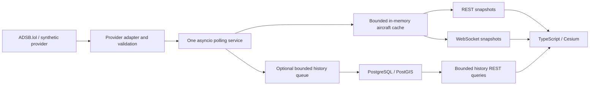

# SkybyDay architecture

Decision baseline: 2026-10-18; Phases 3–6 added 2026-10-19. The foundation,
ingestion, shared backend API, Cesium viewer, bounded movement, optional PostGIS
recording and one-aircraft replay are implemented. Verification is recorded
separately for automated checks, live data, process behavior and browser rendering.
The October 21 local map/UI release adds live-by-default operation, separate weather
and route-reference caches, finer DEN imagery, global place labels and local
building/peak references. See [release verification](local-release-verification.md).

## Scope and acceptance

The first live product will show real aircraft near Denver International Airport
on a selectable Cesium globe, fed by one shared backend poller. Default area:
39.8561° N, 104.6737° W, radius 60 nautical miles. This is a configurable local
area centered approximately on DEN, not an authoritative airport boundary.

Phase 1 is complete when a clean dependency install, Python lint/format/tests,
TypeScript checks/tests/build, backend startup, and browser connection/error
checks pass. It must run without provider credentials or telemetry access.
Phase 2 adds providers, normalization, a cache and polling policy behind a
one-shot CLI. Its gate is offline error/freshness tests plus one attributed live
DEN capture. Phase 3 adds the lifespan poller, aircraft endpoints and WebSockets.
It must share polling across clients, bound delivery, survive provider failures
and cancel cleanly. Phase 4 adds a token-free globe, cached snapshot client,
selection and metadata. Its gate includes actual WebGL rendering, position
updates, altitude distinctions, outage behavior, built assets and a controlled
live check. Phase 5 adds a browser-only delayed display timeline, bounded
geodesic interpolation, labels, ground-track cues, filters and display controls
while preserving the source observation contract. Phase 6 adds optional PostGIS
recording, bounded spatial/time queries and an independent historical clock.

## Data flow

FastAPI owns the adapter, service, cache,
REST routes and WebSocket publisher. The browser consumes REST once on load and
then WebSocket snapshots through Vite's proxy. Separately, `skytrace-ingest`
performs one due fetch and emits a JSON snapshot with an optional local capture.

## Component boundaries

- **Provider:** a small asynchronous `AircraftProvider` interface with a
  `fetch(area)` operation, returning normalized observations and response timing.
  Concrete adapters own wire-schema parsing and source-specific error mapping.
  ADSB.lol and synthetic implementations are available. Each fetch makes at
  most one request; the adapter does not retry. No placeholder OpenSky module.
- **State:** Pydantic v2 models enforce coordinate, identity, finite-number, and
  timezone rules. Distinguish response time, position observation time, and
  local receipt time; see [data-model.md](data-model.md).
- **Service:** `IngestionService.poll_once()` serializes concurrent callers
  and checks a monotonic deadline before fetching. It owns backoff and a bounded
  cache. Snapshot reads never fetch. The lifespan owns one `TelemetryRuntime`
  task and reusable HTTPX client, starts without awaiting the initial fetch,
  and cancels/awaits the task before closing the client on shutdown.
- **API:** return cache snapshots and source health separately. WebSockets
  carry observations, not animation frames. Bound each client to its latest
  pending snapshot, set send deadlines and a connection limit, and disconnect
  slow clients. On reconnect, send a full snapshot so no delta log is needed.
  Defaults: 32 connections, one pending frame per client, 5-second send timeout.
  The runtime serializes each changed broadcast once and shares the string.
  A per-lifespan `stream_id` and sequence identify state changes; the HTTP and
  WebSocket snapshot envelopes match. Changing only emission time or the retry
  countdown does not trigger another broadcast.
- **Browser:** `network/snapshot.ts` validates consumed fields;
  `network/stream.ts` manages a single receive-only WebSocket with bounded retry.
  `aircraft/state.ts` replaces membership by stream/sequence and ages observations
  locally using the server's retention policy. It keeps at most four timestamped
  position samples per ICAO24 and derives a separate display position on a
  delayed timeline. `cesium/globe.ts` reuses entities by ICAO24 and requests
  rendering on changes. `main.ts` owns the inspector, bounded 100-row roster,
  filters, display controls, status and lifecycle cleanup. The synthetic provider
  supplies two deterministic circular fixtures and reports a ground track from a
  one-second forward difference on each fictional path; it does not invent body
  heading, pitch or roll.
- **Persistence:** `history.py` offers each successful provider batch once to
  an eight-batch queue, independently of cache consumers. One writer stores
  positioned canonical observations and attribution as JSONB, with indexed
  source/ICAO/time columns and a WGS84 geography point. A primary key deduplicates
  `(source, icao24, position_observed_at)` with first-write-wins semantics.
  Query and retention paths have deadlines and row limits. PostgreSQL and its
  driver are optional; no startup DDL or broker is needed. Do not derive flight
  identity from callsign alone.
- **Context services:** weather and callsign route references share a separate
  two-connection HTTPX client, independent of the telemetry client's single
  connection. Fixed source URLs, bounded bodies/deadlines, serialized requests,
  cached results and Retry-After handling constrain upstream load. Weather is
  explicitly KDEN-only; route standing data is never confirmed live flight intent.
  These records are not injected into canonical aircraft observations or history.
- **Map context:** the browser loads public imagery/terrain directly. NAIP's fine
  layer is bounded to DEN. FAA airport geometry, chunked GeoNames city labels and
  OSM Denver building/Front Range peak snapshots are served locally, with source
  manifests and licenses. City labels are culled by view, population and screen
  overlap; at most 180 labels and 12 cached chunks are retained. Maps do not create
  aircraft coverage or backend per-viewer polling. See [map sources](maps.md).
- **Replay:** a validated one-aircraft history query populates a separate browser
  timeline of at most 5,000 samples. Playback starts paused at the first sample;
  play/pause and seeking change only this clock. Interpolation uses the same
  geodesic, gap, speed and height rules as live display, without extrapolation.
  Live snapshots continue updating in the background and return-to-live restores
  the shared cache. Historical source attribution and observation time stay visible.

## Reliability and freshness

The ingestion policy starts at 30 seconds, with no overlapping requests within
one service. The deadline is set after each completed attempt. The adapter has
a 5-second connect timeout, 10-second HTTP operation timeouts, and a 15-second
overall deadline. Responses are limited to 4 MiB decoded and 10,000 raw records.
Cancellation propagates; it is not treated as a provider error.

On 429, timeout, transport failure, or 5xx, schedule one later attempt using
bounded exponential backoff and positive jitter. At the default interval,
delays start at 30–36 seconds, then 60–72, and grow to a maximum of 15 minutes.
For configured intervals over 750 seconds, the maximum becomes 1.2 times that
interval so backoff cannot shorten it. A valid `Retry-After` (seconds or
HTTP date) is a lower bound and may exceed that cap; use the greater delay.
Other non-200 statuses, including redirects, suspend attempts until a new
service is created after intervention. Failure count resets after valid success.
An HTTP 200 with a malformed or stale body is not a successful fresh update.
The default maximum snapshot age is 90 seconds, with 5 seconds of future-clock
tolerance. A completely rejected non-empty batch is an error, not an empty sky.

Retain last-known observations through an outage without refreshing their
observation timestamps. The service counts positions stale at 90 seconds and
expires observations at 300 seconds by default, including during reads in a
long backoff. Missing positions count as stale. Metadata-only records expire
using message time, or provider time if message time is absent. A successful
snapshot is authoritative for membership; empty success clears the cache.
For a repeated identifier, an older/missing position cannot replace a retained
newer position: keep the whole older observation without mixing its coordinates
with new metadata. Default capacity is 2,000 observations, keeping the freshest
with a deterministic identifier tie-break. Publish provider status, last
success, and retry delay separately from aircraft freshness.

Deadlines and cached state are process-local. The CLI reports the retry delay
but exits after one attempt; invoking it repeatedly would reset that deadline.
Continuous use runs through the single-owner lifespan loop. Each iteration
checks the due deadline and publishes observation/status/stale/expiry changes,
then sleeps one second. During a request, its 15-second deadline also bounds
the delay before the next local expiry broadcast. HTTP reads always prune on
access. The browser can derive position age from timestamps between messages.
No synthetic heartbeat advances an observation time.

Phase 4 includes configured area/stale/expiry thresholds in every public
snapshot. The browser anchors age to server emission plus monotonic elapsed
time and performs its own stale/removal check each second, including offline.
This approximates age without a synchronized browser wall clock; transit delay
is not measured. The client caps snapshot text at 16 MiB and aircraft at 10,000.
Malformed frames close the connection and trigger bounded reconnects; previous
valid observations keep aging. No unbounded sample history is stored.

Unexpected programming exceptions stop the poller, log a traceback, and publish
`poller_status=failed`; they are not silently retried as provider errors.
Expected outages retain the running task and follow the ingestion backoff policy.
The API can respond before the first fetch with an explicit idle/empty snapshot.

The browser's delayed timeline defaults to the poll interval plus five seconds,
capped at 60 seconds. It stores at most four samples per aircraft and connects
only adjacent observations no more than 60 seconds apart. Cesium's WGS84
`EllipsoidGeodesic` supplies the horizontal path; geometric height is linearly
interpolated only when both endpoints have the same height availability. A
conservative 1,500 m/s horizontal jump guard rejects implausible display
segments. Before the first bracket, after the last bracket, across a rejected
segment or when the earlier endpoint is stale, the browser holds or shows the
latest observed position. It never extrapolates indefinitely. Stale state still
uses the latest observation age and disables motion; expiry removes the aircraft.
Display coordinates and timestamps remain separate from canonical measurements.
Ground-track arrows are fixed 4 km visual cues based on the latest reported
ground track. They are not speed vectors, predicted destinations or body
heading; missing true/magnetic heading, pitch and roll remain unknown.

## Runtime and security

Optional history uses the Psycopg async driver directly. Database operations
have five-second deadlines, with at most two concurrent query connections and
one writer. A failed write retries after 5, 10 and 20 seconds, then drops that
batch with an observable counter. A full queue drops incoming batches. Shutdown
allows three seconds to drain before cancelling and counting undrained work.
Committed rows survive restart; the queue and counters do not. This is bounded
best-effort recording, not a lossless archive. Retention deletes up to 10,000
expired rows after each successful batch. See [history operations](history.md).

Local commands bind to `127.0.0.1`. Vite proxies relative `/api` URLs; no CORS
middleware or wildcard origins are enabled. There are no administrative HTTP
routes. Optional database credentials stay in local settings and are omitted
from public status and configuration error messages. Default startup polls live
ADSB.lol. Synthetic fixtures require explicit selection for development/tests;
provider failures never switch to them. `.env` is ignored
by Git. Health exposes only source/status/count, area and polling information.
WebSocket origins must exactly match configured HTTP(S) origins; missing, null,
duplicate or unlisted origins are denied before acceptance. Incoming application
messages close the socket; clients only receive snapshots. The documented
Uvicorn command also limits incoming WebSocket messages to 1,024 bytes.

Before any VPS deployment, define TLS, authentication if needed, allowed HTTP
and WebSocket origins, client limits, and a reverse proxy. CORS is not
authentication. Multiple backend workers would multiply polling; use one worker
until ingestion is separated into a single shared service. Repeated process
restarts also reset rate-limit deadlines; avoid reload in live mode. Do not expose the
Vite development server as a public production server.

## Risks and decisions

| Risk | Mitigation / milestone gate |
| --- | --- |
| Dynamic quotas and provider outages | Shared polling, Retry-After, jitter, synthetic fixtures; Phase 2 |
| Schema and timestamp differences | Synthetic fixtures and explicit units; deployed millisecond encoding confirmed in Phase 2 |
| Missing or stale positions | Independent position age, bounded cache, stale UI; Phases 2–5 |
| Misleading altitude or orientation | Preserve datums/provenance and unknown fields; never equate pressure altitude with terrain height |
| Cesium assets or GPU support | Bundle workers/assets, verify real browser/WebGL behavior; Phase 4 |
| Imagery licensing / cloud dependency | USGS aerial / Mapzen terrain with attribution and bounded requests; bundled world and flat fallback; FAA reference snapshot carries dates and source terms ([maps](maps.md)) |
| Data license versus code license | MIT code; separate provider attribution and ODbL handling |
| Storage outage / backlog | Bounded queue, deadlines, finite retry and drop counters; live ingestion remains independent |
| Premature complexity | No frontend framework, ORM, broker, scheduler library or NumPy; only optional Psycopg and PostGIS for recording |

See [provider research](provider-research.md), [technology decisions](decisions.md),
and the [phase roadmap](roadmap.md). The [Phase 4 verification](phase-4-verification.md)
and [Phase 5 verification](phase-5-verification.md), plus the
[release verification](phase-6-verification.md), separate automated, process,
browser and live-provider evidence.
